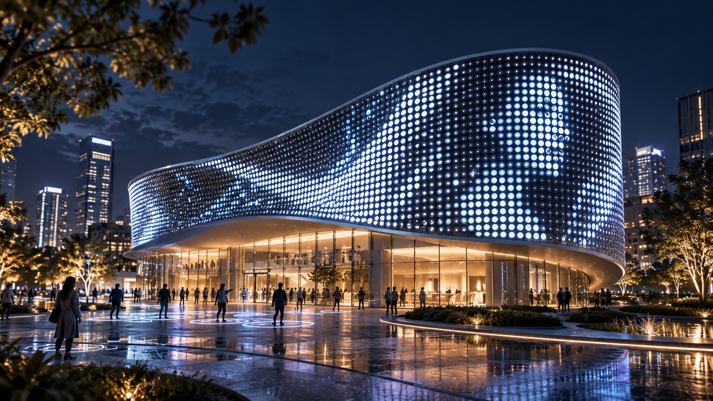
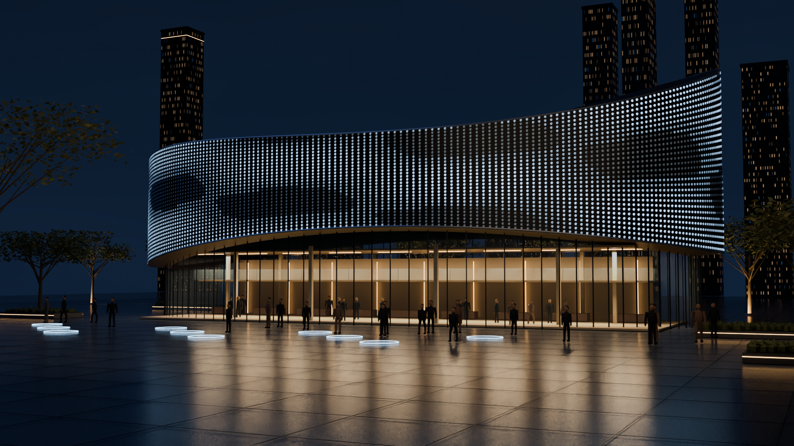
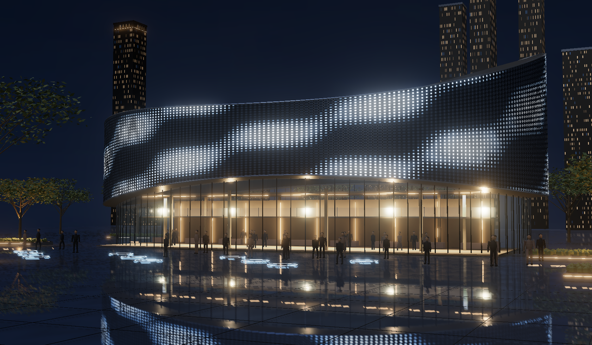
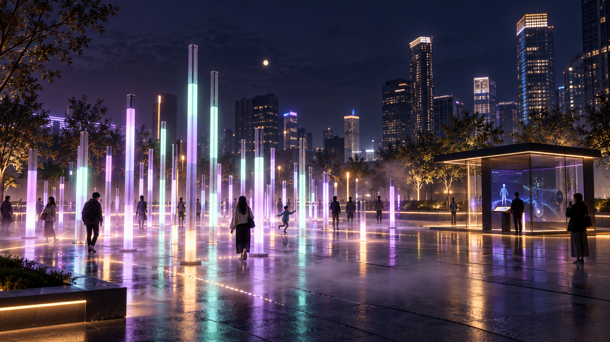
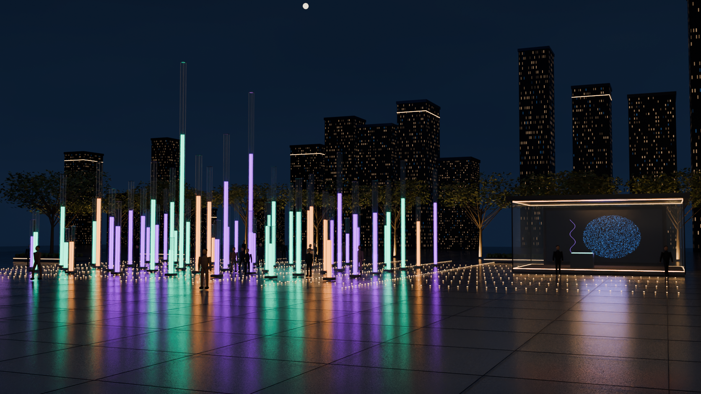
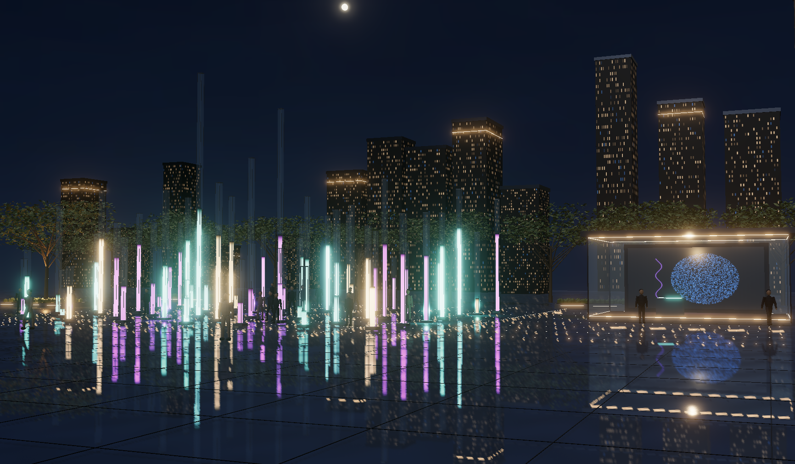

# Blender 双场景交付与验证

完成日期：2026-10-22。两套场景已经接入现有夜景工作台，保留城市穹顶与照片实验。入口为 [本地网页](http://127.0.0.1:4187/lab?mode=lightform)，选择“流线灯幕”或“光柱广场”。

## 交付文件

| 场景 | Blender 源工程 | 网页 GLB | 标准交换 GLB |
|---|---|---|---|
| 流线灯幕 | [fluid.blend](../blender/night-scenes/fluid.blend) | [fluid-web.glb](../public/assets/light-lab/night/models/fluid-web.glb) | [fluid-standard.glb](../blender/night-scenes/exports/fluid-standard.glb) |
| 光柱广场 | [field.blend](../blender/night-scenes/field.blend) | [field-web.glb](../public/assets/light-lab/night/models/field-web.glb) | [field-standard.glb](../blender/night-scenes/exports/field-standard.glb) |

源工程贴图已打包，使用米制单位；GLB 的源模型到回导模型，显示面尺寸误差小于 1 毫米。标准交换 GLB 提供静态 PBR 灯效预览；网页 GLB 使用 Meshopt 和 KTX2，动态灯幕、光柱、反射和辉光由 Three.js 补齐。

网页保留图片、视频、Chroma、Fluid 和粒子流场映射。光柱独立运行，默认紫青暖色预设，可切换暖白向上呼吸循环。两个新场景的镜头均限制在参考视角附近，并提供复位；城市穹顶的原有浏览方式保持不变。

## 官方 MCP

Blender 5.1.2；官方 Blender Lab 插件与服务端 1.0.3；源码固定为 `2cea8d566dde07fbac28a61d698909d69724e853`。安装位置为用户 `.codex/tools/blender-mcp-official`，Codex 服务名为 `blender-official`，桥接监听 `127.0.0.1:9876`。已验证 MCP 握手、26 个工具发现、场景读取和截图，并通过真实 MCP 执行建模、Cycles 烘焙、GLB 导出及渲染。

[连接记录](blender-mcp-connection.json)；[Python 依赖锁](../blender/night-scenes/blender-mcp-uv.lock)；[本机重建步骤](../blender/night-scenes/README.md)。官方来源：[安装页](https://www.blender.org/lab/mcp-server/)、[固定版本源码](https://projects.blender.org/lab/blender_mcp/src/tag/v1.0.3)。

官方 CLI 校验工具继承本机用户插件后启动超时；只读的源工程重开和标准 GLB 回导改用 `--factory-startup` 隔离进程，已通过。[流线灯幕回导结果](fluid-blender-validation.json)、[光柱广场回导结果](field-blender-validation.json)。该替代只用于校验，场景制作和导出实际经 MCP 完成。

## 桌面性能

Chrome，1920×1080 页面，DPR 1，生产构建，每景预热约 6 秒并采样 60 秒。GPU：ANGLE (NVIDIA, NVIDIA GeForce RTX 5080 (0x00002C02) Direct3D11 vs_5_0 ps_5_0, D3D11)。测量为浏览器实际呈现帧间隔，当前高刷新率环境可超过 60 FPS。

| 场景 | 网页 GLB | 模型三角形 | 总绘制调用 | 平均 FPS | P95 帧间隔 |
|---|---:|---:|---:|---:|---:|
| 流线灯幕 | 8.77 MiB | 453,674 | 71 | 239.8 | 4.30 ms |
| 光柱广场 | 5.28 MiB | 176,332 | 176 | 239.8 | 4.30 ms |

绘制调用包含地面反射与后处理。共享 Basis 解码器约 0.56 MiB，两景各自资源均低于 25 MiB。模型按需加载，地面反射使用半分辨率，重复几何按材质合批。离开工作台后已验证 WebGL 纹理和缓冲释放。该性能只代表本机 RTX 5080，未测试其他显卡、Safari、Firefox 或移动设备。

[模型校验详情](night-scene-assets.json)；[60 秒采样详情](night-desktop-benchmark.json)。

## 验收

| 检查 | 结果 |
|---|---|
| 页面身份、有效内容、无框架错误覆盖层 | 通过 |
| 浏览器相关控制台错误 | 0 |
| 36 项单元测试、TypeScript 与生产构建 | 通过 |
| 21 项桌面媒体与夜景集成测试 | 通过 |
| 连续 UV、媒体上下方向、横竖和方形图片、视频及实时素材 | 通过 |
| 紫青默认预设、暖白循环、预设保留、独立光柱 | 通过 |
| 镜头范围、精确复位、模型加载失败重试、GPU 资源释放 | 通过 |
| 源工程无缺图、标准 GLB 回导、比例和三角形一致 | 通过 |

验收使用项目 Playwright + Chrome，Browser 插件在本次环境中不可用。复现命令为 `npm test`、`npm run build`、`npx playwright test tests/night-scenes.spec.ts tests/lab-imports.spec.ts --project=desktop`。生产服务运行后，以 `NIGHT_URL` 指向服务并执行 `node scripts/review-night-scenes.mjs 60` 可重测。

## 参考图、Blender 与网页对照

以下为同一主视角的视觉对照；灯效动画相位不同，网页色调映射与 Cycles 的高光响应也有差异。重建优先保留流线轮廓、点阵密度、暖色大厅、错落灯柱、紫青配色与湿地反射。人物、植被和远景建筑采用简化几何，精细度与参考图中的摄影级配景仍有差距；尺寸为图像推估，并非施工模型。

### 流线灯幕

参考图：

Blender Cycles：

网页实时画面：

### 光柱广场

参考图：

Blender Cycles：

网页实时画面：

本次交付为本地可运行版本，未发布线上。
